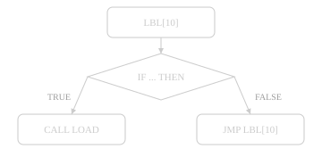

# Read a TP Program

Open `S002R01/LS/LOAD.LS`. Hover an instruction, a register and a `P[n]`; open the **Outline**; then draw the program as a flow chart.

**You should see** a hover card on `R[5]` reading *Part Count*, and a flow chart in a new tab showing the branch structure.

[Show Program Flow](command:robotCode.tp.showFlow)
