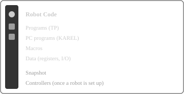

# Explore the Sidebar

The **Robot Code** panel groups what you work with. The first four sections come from your files; **Snapshot** and **Controllers** appear once you work with a robot.

**You should see** the Robot Code icon in the Activity Bar, and a panel listing **Programs**, **PC programs**, **Macros** and **Data**.

[Show the Robot Code View](command:workbench.view.extension.robotCode)
