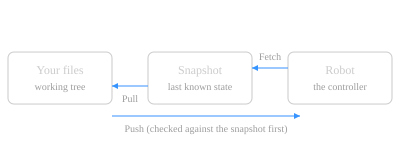

# Take a Snapshot

The snapshot is the robot's **last known state** - the base every comparison is against, like git's index.

Take one from a backup folder (works offline) or, once connected, from the robot itself.

**You should see** the robot in the **Snapshot** view, and a `=` or `≠` marker beside each working program.

[Snapshot from Backup Folder…](command:robotCode.data.snapshotFromBackup)
