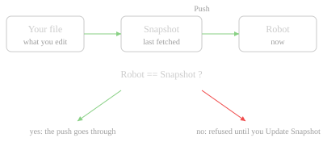

# Fetch, Compare, Push

- **Fetch** updates the snapshot; it never touches your file.
- **Pull** brings the robot's copy into your file (one Ctrl+Z).
- **Push** sends your file to the robot - the one write - and is refused if the robot changed since the snapshot.
- **Revert** puts your file back to the snapshot.

**You should see** the snapshot's file ages update, and a program that changed on the robot marked `↓n`.

[Fetch from Robot…](command:robotCode.sync.fetch)
